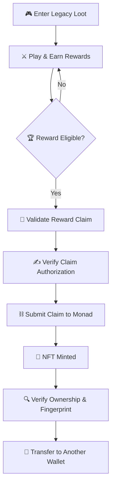
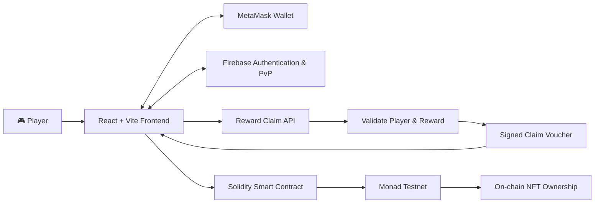

# ⚔️ LEGACY LOOT
### Your loot. Your legacy. Your ownership.

<p align="center">
  <strong>🎮 Player-Owned Gaming Assets That Survive the Game</strong>
</p>

<p align="center">
  A blockchain-powered gaming experience where achievements become verifiable digital assets, giving players a way to prove ownership beyond a game's centralized database.
</p>

<p align="center">
  <a href="https://legacy-loot.vercel.app">
    
  </a>
  <a href="https://testnet.monadexplorer.com/">
    
  </a>
  
  
</p>

---

## ✨ The Story Behind Legacy Loot

**Imagine spending 100 hours earning a legendary sword. What happens if the game disappears tomorrow?**

Your character, your achievements, and your hard-earned items may become inaccessible if the game company loses its data or shuts down its servers.

Traditional backups help recover data, but players still depend on the game company to manage and restore their records.

Legacy Loot explores another approach: **give players a blockchain-verifiable record of ownership for valuable digital items.**

Your game may depend on a server. Your NFT ownership record does not have to.

## 🎯 The Problem

- 🗄️ **Centralized ownership:** In-game assets are commonly controlled through a game's database.
- ⚠️ **Single-platform dependency:** Access to an item may depend on the game remaining operational.
- 🔒 **Limited portability:** Players cannot automatically use assets across unrelated games.
- 💎 **Achievements stay inside the game:** Valuable items may have no independently verifiable ownership record.

## 💡 Our Solution

Legacy Loot connects gaming achievements with blockchain-based digital ownership.

- ⚔️ **Earn:** Play the game and unlock artifacts.
- 🏆 **Claim:** Eligible rewards can be claimed through a smart contract.
- ⛓️ **Own:** Minted artifacts are represented as NFTs on Monad Testnet.
- 🔍 **Verify:** Inspect on-chain ownership and verify an artifact's fingerprint.
- 🔄 **Transfer:** Transfer supported NFTs between compatible wallets.

> **Our vision:** Gaming assets should be more than database entries. They should have verifiable ownership that players can carry beyond a single game.

---

## 🎮 Experience the Game

<p align="center">
  <a href="https://legacy-loot.vercel.app">
    <strong>🚀 LAUNCH LEGACY LOOT →</strong>
  </a>
</p>

Explore the game, connect your wallet, discover artifacts, and experience the NFT ownership flow.

**Network:** Monad Testnet  
**Chain ID:** `10143`

*The live website and blockchain features may require a connected wallet, testnet funds, and a working reward service. Use the live demo to verify which features are currently operational.*

---

## 🔥 How It Works



### 🧩 The Claim Journey

| Stage | What happens |
|---|---|
| 01 — Play | The player earns an eligible artifact. |
| 02 — Authorize | The reward service validates the claim and provides an authorization signature. |
| 03 — Approve | The player's wallet requests confirmation for the blockchain transaction. |
| 04 — Mint | The smart contract validates the claim and records NFT ownership. |
| 05 — Verify | The player can inspect ownership and artifact fingerprint information. |

*The authorization and minting steps depend on the deployed backend and contract configuration.*

---

## 🏗️ System Architecture



### 🛠️ Technology Stack

| Layer | Technology |
|---|---|
| Frontend | React, Vite, JavaScript |
| Wallet integration | MetaMask, ethers.js |
| Smart contracts | Solidity |
| Blockchain | Monad Testnet |
| Multiplayer and authentication | Firebase |
| Reward authorization | Backend API with signed claims |
| Deployment | Vercel for the frontend; configure a backend host separately |

---

## ⛓️ Smart Contract

### Deployment Network

**Deployment network: Monad Testnet**  
**Chain ID: `10143`**

Monad Testnet is the test blockchain network intended for deploying and testing the Legacy Loot smart contract before any mainnet deployment.

### Contract Address

`0x2C08E4c20d5867A04cB2A18B6568aB0fF74ec051`

- **Network:** Monad Testnet
- **Explorer:** [Open Monad Testnet Explorer](https://testnet.monadexplorer.com/)

> **Deployment verification required:** This address was taken from the project's previously discussed frontend configuration. Before submitting, open the explorer and confirm that a contract deployment exists at this address on Monad Testnet. If your final deployment uses a different address, update it here. Do not describe the contract as successfully deployed until you have verified it.

### Contract Capabilities

The frontend is configured to interact with contract methods including:

- `claimArtifact(...)` — claim an artifact using its authorized reward data.
- `ownerOf(tokenId)` — inspect the current NFT owner.
- `tokenURI(tokenId)` — retrieve the NFT metadata URI.
- `metadataHash(tokenId)` — inspect the stored metadata fingerprint.
- `verifyFingerprint(...)` — verify an artifact fingerprint.
- `transferFrom(...)` — transfer an NFT to another wallet.

The contract, rather than the README, is the authoritative source for actual access controls and transaction behavior.

---

## 🧪 Getting Started

### Prerequisites

- [Node.js](https://nodejs.org/) and npm
- [Git](https://git-scm.com/)
- [MetaMask](https://metamask.io/)
- A wallet configured for Monad Testnet
- Access to the Firebase project configuration
- A running reward API for authenticated NFT claims

### 1. Clone the repository

```bash
git clone https://github.com/Anushka-Gurav/LegacyLoot.git
cd LegacyLoot
```

### 2. Start the frontend

```bash
cd frontend
npm install
```

Create a `.env` file in the frontend directory using the variable names expected by the application.

Example:

```env
VITE_REWARD_API_URL=http://localhost:8787
```

Configure the Firebase client settings using the project's expected `VITE_` variables. Do not put Firebase Admin credentials or private signing keys in frontend environment variables.

Start the development server:

```bash
npm run dev
```

Open the local URL printed by Vite in your terminal.

### 3. Start the backend

Open a separate terminal:

```bash
cd backend
npm install
```

Configure the backend's required environment variables in a local `.env` file, based on the backend configuration:

```env
PORT=8787
FRONTEND_ORIGIN=http://localhost:5173
MONAD_CHAIN_ID=10143
CONTRACT_ADDRESS=YOUR_DEPLOYED_CONTRACT_ADDRESS
CLAIM_SIGNER_PRIVATE_KEY=YOUR_SERVER_SIDE_SIGNER_KEY
FIREBASE_SERVICE_ACCOUNT_JSON=YOUR_SERVER_SIDE_FIREBASE_CREDENTIALS
FIREBASE_DATABASE_URL=YOUR_FIREBASE_DATABASE_URL
```

**Security:** These are illustrative variable names. Follow the backend's actual configuration and secret format. Never commit `.env` files, private keys, or service-account credentials. Use a dedicated testnet signer and rotate any credentials that have been exposed.

Start the backend using the script defined in its `package.json`, for example:

```bash
npm run start
```

If your backend uses a different start script, use that script instead.

### 4. Connect and test

1. Open the frontend.
2. Connect MetaMask.
3. Switch to Monad Testnet, chain ID `10143`.
4. Confirm that the reward API is running and configured.
5. Complete the reward flow required by the application.
6. Claim an eligible artifact and approve the transaction in MetaMask.
7. Verify the resulting transaction and NFT ownership on the explorer.

**Note:** A local demo unlock is not necessarily a valid blockchain reward claim. The reward service and contract must accept the claim before minting can succeed.

---

## 🛡️ Security & Design Principles

- **On-chain verification:** NFT ownership can be checked independently of the game's UI.
- **Authorized claims:** Reward signatures help the contract validate eligible claims.
- **Fingerprint verification:** Hashes can help detect changes to the data being verified.
- **Wallet-based ownership:** Players control the wallet that holds their NFTs.

Blockchain is not a replacement for backups. Game progress, metadata availability, and cross-game support still require appropriate infrastructure and integrations.

---

## 🗺️ Roadmap

- [x] React-based gaming interface
- [x] Monad Testnet integration in the frontend
- [x] Artifact claim flow implementation
- [ ] Verify the final public contract deployment
- [ ] Demonstrate successful minting from the live public website
- [ ] Strengthen production security and recovery processes
- [ ] Integrate a compatible external game or asset viewer
- [ ] Improve durable metadata availability and asset portability

*Update the checklist to reflect only features that have actually been completed and tested.*

---

## 👥 Built For

**Monad Blitz Pune V3**

Legacy Loot explores the intersection of gaming, digital ownership, and blockchain infrastructure.

We believe players should have stronger ownership guarantees for the digital assets they earn.

<p align="center">
  <strong>⚔️ Earn the loot. Own the legacy. ⛓️</strong>
</p>

<p align="center">
  <a href="https://github.com/Anushka-Gurav/LegacyLoot">GitHub Repository</a>
  &nbsp; • &nbsp;
  <a href="https://legacy-loot.vercel.app">Live Demo</a>
  &nbsp; • &nbsp;
  <a href="https://testnet.monadexplorer.com/">Monad Explorer</a>
</p>
